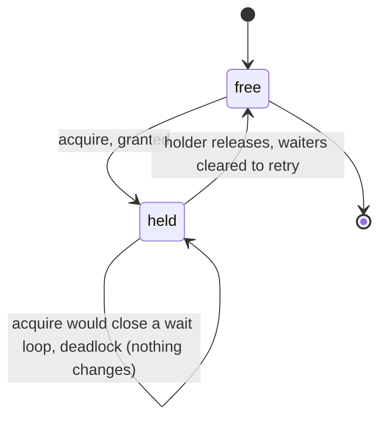
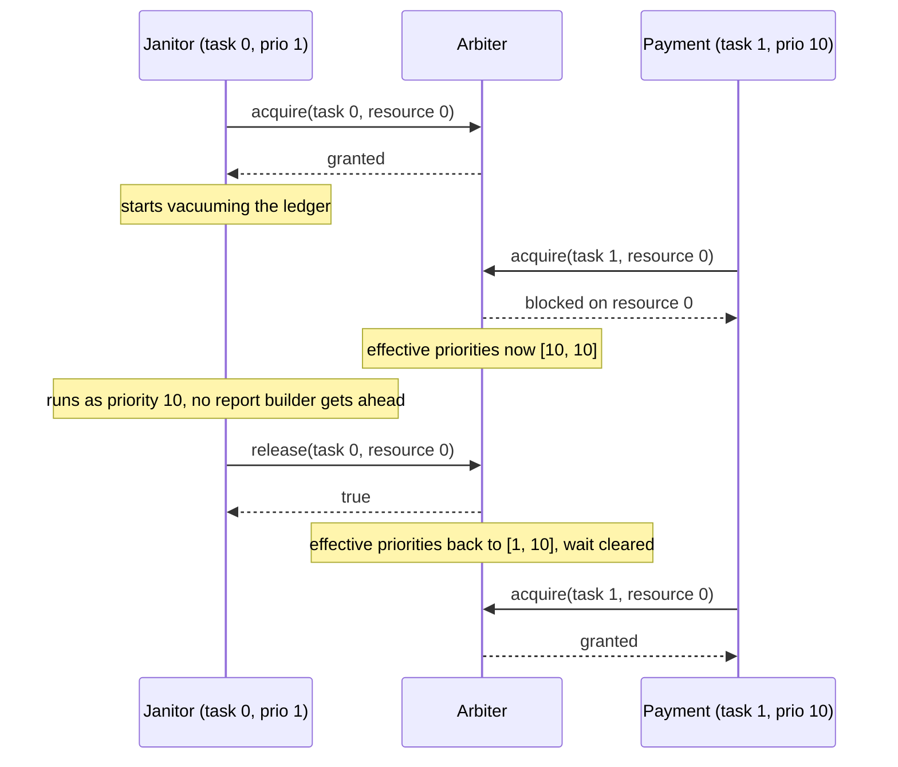

# ArbiterMachines

> When the slow job holds the key the urgent job needs, more workers won't help. 🛰️

A priority arbiter for Ruby. You declare your tasks with their priorities and your resources with their ceilings. The `Arbiter` tells you who may take what, who has to wait, who just inherited someone else's urgency, and who is about to deadlock. Your code still takes and releases the actual locks. The arbiter only ever answers one question: is this a good idea right now?

## Quick Start

```bash
gem 'arbiter_machines'
```

```ruby
# Two tasks: a janitor at priority 1, a payment at priority 10.
# One resource: the ledger lock, ceiling 10.
arbiter = ArbiterMachines::Arbiter.new(
  priorities: [1, 10],
  ceilings: [10],
  protocol: :inheritance
)

arbiter.acquire(task: 0, resource: 0)   # => [:granted, nil]   janitor takes the ledger
arbiter.acquire(task: 1, resource: 0)   # => [:blocked, 0]     payment waits on resource 0
arbiter.effective_priorities            # => [10, 10]          janitor now runs as urgent

arbiter.release(task: 0, resource: 0)   # => true              janitor done, wait cleared
arbiter.acquire(task: 1, resource: 0)   # => [:granted, nil]   payment retries and gets in
```

Tasks and resources are positional indices into the arrays you passed in. Larger number means more urgent.

## A Message to the Resistance

So you gave the nightly cleanup job priority 1, the payment processor priority 10, and a pile of report builders priority 5. Sensible. Then one night the cleanup job took the ledger lock for a quick vacuum, the payment job arrived and blocked on it, and twelve report builders showed up and ran. All of them. Before the cleanup job got another slice of CPU.

The payment job, your most urgent work, sat behind priority-5 reports because a priority-1 job was holding its lock and nobody told the scheduler that the priority-1 job was suddenly very important.

That's priority inversion. It put a rover on Mars into a reboot loop in 1997, and it's been quietly doing the same thing to job queues ever since. The fix has been known just as long: while the janitor holds something the payment job needs, the janitor *is* the payment job. It inherits the urgency, finishes fast, hands the lock over.

This gem does the accounting for that. Who holds what, who waits on whom, what everybody's priority really is right now, and whether the next acquire closes a loop nobody can escape from.

## Chapter 1: Stardate 2025.186, the AMS Dijkstra

> **AMS Dijkstra**, NCC-4201, *Dijkstra*-class traffic-control vessel.
> One airlock. Two waiting crews. No circular holding pattern.

The vessel doesn't open airlocks. It keeps the chart: which crew is in which lock, which crew is waiting at which door, and which crew's urgency has been lent to the crew blocking it. Before any crew is cleared to wait, the chart is checked for a loop. A loop is never charted, because a charted loop is a ship nobody leaves.

Somewhere on the bridge, a junior officer suggests:

```ruby
def process_payment
  ledger_lock.synchronize do   # the janitor has this, and the janitor is slow
    charge_card
  end
end
```

"That," says the traffic controller, "is how urgent work waits for the floor to be mopped."

## The Flight Plan

Every resource is either free or held. Every task is either running, holding, or waiting at exactly one door.



And the night the janitor held the ledger:



## How Arbitration Works

### Acquire

`acquire` returns a two-element array: a status and, when blocked, the resource index you're waiting on.

```ruby
arbiter = ArbiterMachines::Arbiter.new(
  priorities: [1, 5, 10], ceilings: [10, 10], protocol: :inheritance
)

arbiter.acquire(task: 0, resource: 0)   # => [:granted, nil]
arbiter.acquire(task: 0, resource: 0)   # => [:already_owned, nil]
arbiter.acquire(task: 1, resource: 1)   # => [:granted, nil]
arbiter.acquire(task: 1, resource: 0)   # => [:blocked, 0]
```

Task 1 now holds resource 1 and is waiting on resource 0, which task 0 holds.

### Inheritance is transitive

Urgency flows up the chain. If a third task waits on task 1, task 1 gets its priority, and so does task 0 behind it.

```ruby
arbiter.acquire(task: 2, resource: 1)   # => [:blocked, 1]
arbiter.effective_priorities            # => [10, 10, 10]
```

Task 2, priority 10, waits on task 1. Task 1 waits on task 0. Everybody in the chain runs at 10 until the chain clears.

### Release and retry

Releasing clears the waits on that resource. It does not hand the resource to anyone. The waiters call `acquire` again, and the arbiter decides fresh.

```ruby
arbiter.release(task: 0, resource: 0)   # => true
arbiter.effective_priorities            # => [1, 10, 10]  task 1 still blocks task 2
arbiter.acquire(task: 1, resource: 0)   # => [:granted, nil]
```

Release by a task that doesn't hold the resource returns `false` and changes nothing.

### Stop waiting

A task that gives up on a door calls `cancel_wait`. Its held resources stay held. Only the wait is dropped, and the urgency it was lending goes with it.

```ruby
arbiter = ArbiterMachines::Arbiter.new(
  priorities: [1, 5, 10], ceilings: [10, 10], protocol: :inheritance
)
arbiter.acquire(task: 0, resource: 0)
arbiter.acquire(task: 2, resource: 0)   # => [:blocked, 0]
arbiter.effective_priorities            # => [10, 5, 10]

arbiter.cancel_wait(task: 2)            # => true
arbiter.effective_priorities            # => [1, 5, 10]
```

### Deadlock is refused, not reported after the fact

Two tasks each holding what the other wants is a loop. The arbiter sees it before charting the second wait and returns `:deadlock`. Nothing about the current state changes, so you can back out cleanly.

```ruby
arbiter = ArbiterMachines::Arbiter.new(
  priorities: [1, 5, 10], ceilings: [10, 10], protocol: :inheritance
)
arbiter.acquire(task: 0, resource: 0)
arbiter.acquire(task: 1, resource: 1)
arbiter.acquire(task: 0, resource: 1)   # => [:blocked, 1]
arbiter.acquire(task: 1, resource: 0)   # => [:deadlock, nil]
arbiter.effective_priorities            # => [1, 5, 10]  untouched

arbiter.cancel_wait(task: 0)            # => true, task 0 backs off
arbiter.acquire(task: 1, resource: 0)   # => [:blocked, 0]  now it's a plain wait
```

### The other protocol: immediate ceiling

With `:immediate_ceiling`, a task jumps to the resource's ceiling the moment it takes the resource, before anyone has to wait. Nobody with a priority at or below the ceiling can get in behind it.

```ruby
arbiter = ArbiterMachines::Arbiter.new(
  priorities: [1, 5, 10], ceilings: [8, 10], protocol: :immediate_ceiling
)
arbiter.acquire(task: 0, resource: 0)   # => [:granted, nil]
arbiter.effective_priorities            # => [8, 5, 10]   task 0 raised to the ceiling
arbiter.acquire(task: 1, resource: 1)   # => [:blocked, 0] priority 5 can't clear a ceiling of 8
arbiter.acquire(task: 2, resource: 1)   # => [:granted, nil] priority 10 can
```

A ceiling has to be at least as high as every task that will ever take the resource. Task 2 at priority 10 asking for resource 0 with ceiling 8 is a misdeclaration, and the arbiter says so:

```ruby
arbiter.acquire(task: 2, resource: 0)   # => [:invalid, nil]
```

## The Rules of the Vessel

- **Up to 8 tasks and 8 resources**, chosen independently by the lengths of `priorities:` and `ceilings:`. Empty or longer arrays raise `ArgumentError`.
- **Priorities, ceilings, and indices are non-negative Integers** below `2**32`. Floats and strings raise `TypeError`, out-of-range raises `RangeError`.
- **Out-of-range task or resource indices** in `acquire` return `[:invalid, nil]`. In `cancel_wait` they return `false`. Nothing raises for a bad index, only for a bad type.
- **`effective_priorities` is a fresh Array** every call. Mutate it all you like, the arbiter doesn't care.
- **Frozen means frozen.** `freeze` the arbiter and `acquire`, `release`, and `cancel_wait` raise `FrozenError`. Reads still work.
- **Ceilings are always required**, even under `:inheritance`, where they're not consulted.

## What You Think You're Doing vs Reality

### You Think: "Priority 10 means it runs first."
### Reality: Priority 10 means it waits first, behind whoever holds its lock.

A priority is a promise about scheduling, not about locks. The moment a high-priority task blocks on a lock held by a low-priority one, every medium task in the system is effectively more urgent than your most urgent work. Inheritance is what makes the number mean something again.

## What's Yours

The arbiter never touches a mutex, a thread, or a scheduler. When it says `:granted`, you take the lock. When it says `:blocked`, you wait however you wait, then ask again after the holder releases. When it reports an effective priority, you're the one who has to tell your scheduler. Keep one arbiter per group of resources, and keep its calls serialized.

## License

MIT License. See [LICENSE.txt](LICENSE.txt) for details.

**Remember: Nobody can hear the payment job scream while the janitor mops at priority 1.**
